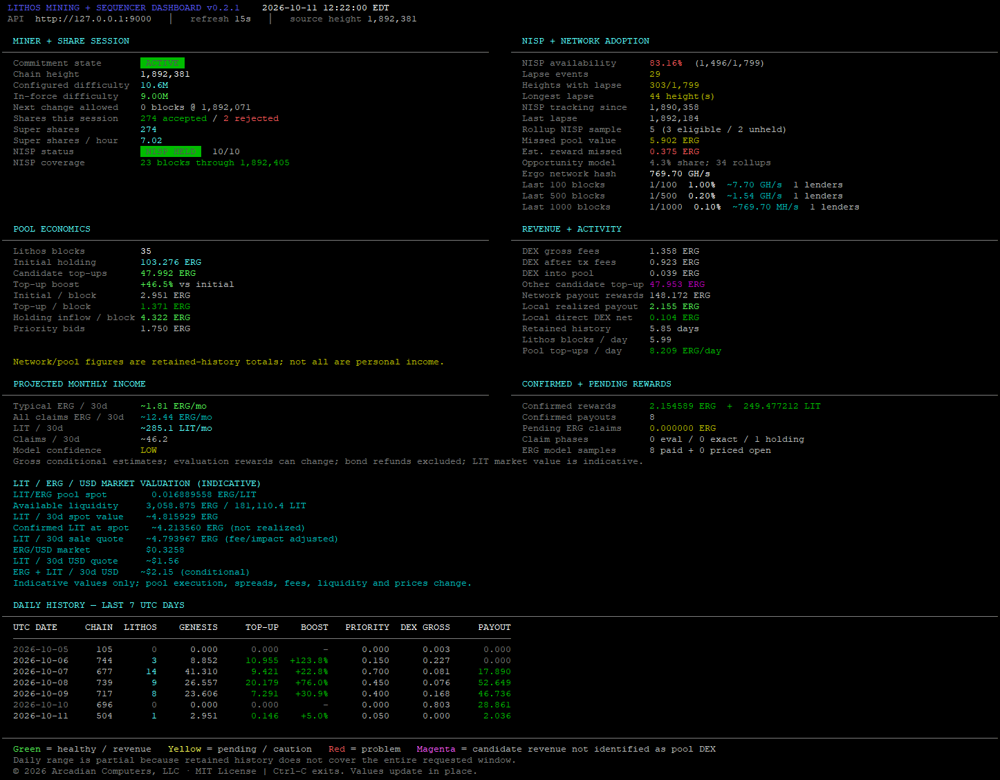
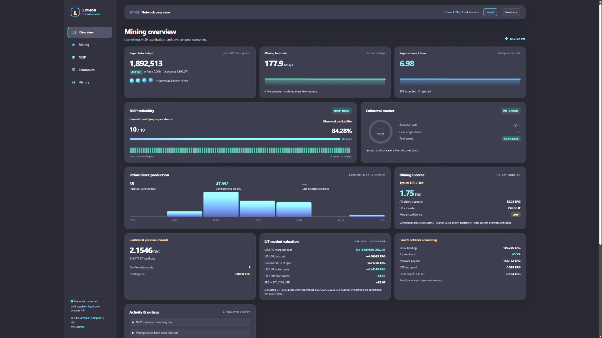

# Lithos Dashboard
[](https://github.com/arcadiancomp/lithos_dashboard/actions/workflows/test.yml)


Single-file Python dashboard for Lithos Protocol mining on Ergo.

Maintained by Arcadian Computers, LLC. Licensed under MIT.

## Screenshots

### Numeric dashboard



Traditional full numeric interface for terminal-focused monitoring and detailed pool accounting.

### Web UI



Browser-based interface with live mining overview, NISP reliability, economics, and historical activity panels.

## Features

- Real-time browser dashboard with animated charts
- Original full numeric terminal dashboard
- Mining difficulty, shares, hashrate and NISP monitoring
- Collateral utilization and on-chain Lithos activity
- Confirmed ERG and LIT mining rewards
- Estimated monthly earnings and LIT market valuation
- Read-only LithosDex sale quotes and ERG/USD conversion
- Python standard library only

## Requirements

- Python 3
- Lithos Client HTTP API
- Ergo node API for optional network adoption analysis

## Installation

```sh
git clone https://github.com/arcadiancomp/lithos_dashboard.git
cd lithos_dashboard
chmod +x lithos_dashboard
```

## Usage

```sh
./lithos_dashboard
./lithos_dashboard --numeric
./lithos_dashboard --web
./lithos_dashboard --web --web-listen 0.0.0.0
./lithos_dashboard --help
```

The numeric interface is the default.
The browser interface defaults to localhost on TCP port 8787.
Binding all interfaces is intended only for trusted networks.
The web interface has no authentication.

The default Lithos API is http://127.0.0.1:9000.
Market prices and income projections are estimates, not guarantees.
Read-only swap quotes never execute blockchain transactions.

## Author and license

Copyright (c) 2026 Arcadian Computers, LLC.
MIT License. See LICENSE.
